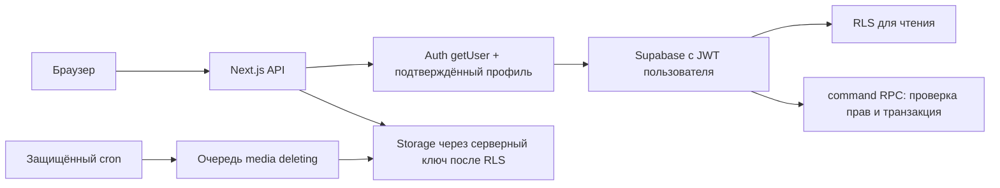

# Архитектура и правила доступа

## Поток запроса

Основная авторизация выполняется заново на сервере, а доступ к таблицам ограничен RLS. Proxy обновляет cookie, но не заменяет проверки в API. Ключ service-role импортируется только из `server-only` модуля. Он используется для Storage, rate limiting Auth, очистки и удаления аккаунта. Ленты и пользовательские команды исполняются с JWT самого пользователя.

У обычных клиентов нет DML-грантов и write-политик таблиц. Все изменения идут через `command`, который сам получает `auth.uid()`, школу и права из подтверждённого, незаблокированного профиля. Данные `school_id`, `role`, `author_id`, `approved` из чужого JSON не являются полномочиями. SQL-функции с SECURITY DEFINER имеют пустой search_path, полностью квалифицированные имена, отозванный PUBLIC EXECUTE. Служебные функции доступны только service-role.

## Матрица

Все разрешения ниже действуют **только внутри своей школы**, после подтверждения email и при отсутствии блокировки.

| Действие | Ученик | Учитель | Модератор | Администратор |
|---|---|---|---|---|
| Читать новости и активные истории | Да | Да | Да | Да |
| Публиковать историю / удалить свою | Да | Да | Да | Да |
| Удалить чужую историю | Нет | Нет | Да | Да |
| Публиковать новости | Нет | Если редактор | Если редактор | Если редактор |
| Удалять новости | Нет | Свои, если редактор | Да | Да |
| Создать обращение / видеть свои | Да | Да | Да | Да |
| Читать одобренные публичные проблемы | Да | Да | Да | Да |
| Модерировать публичные проблемы | Нет | Нет | Да | Да |
| Читать чужие личные обращения | Нет | Если назначен взрослым | Нет | Если назначен взрослым |
| Смотреть жалобы на истории | Нет | Нет | Да | Да |
| Управлять приглашениями и правами | Нет | Нет | Нет | Да |
| Читать журнал модерации | Нет | Нет | Нет | Да |

Директор/владелец Supabase и держатель service-role имеют технический доступ к БД. Это не сквозное шифрование и не абсолютная анонимность. Школе нужно ограничить эти учётные записи.

## Публичные и конфиденциальные обращения

`requests` содержит текст, категорию, статус и флаги, но не автора. `request_authors` хранит привязку отдельно. Обычный ученик видит автора только своих обращений. Ответственные видят имя по RLS. API не добавляет чужой `author_id` в школьную ленту. Идентификаторы и имена поддержавших не выдаются: клиент получает собственную реакцию и общее количество через ограниченный RPC.

Все обращения изначально `approved=false`. Конфиденциальное нельзя сделать публичным ни через API, ни прямым RPC. Обычный модератор не может читать такой текст, фото, автора или историю статусов. Публичную проблему с персональными обвинениями следует отклонить и предложить автору отправить личное обращение; автоматической публикации нет.

Фото обращения сначала является временным `ready` объектом, доступным только загрузившему. После прикрепления проверяется доступ к родительскому обращению. Модератор не получает файловый доступ только из-за знания UUID.

Журнал содержит только действие, UUID объекта/модератора и время. Ответы и персональные тексты не копируются в audit_log. История обращения с ответами защищена той же RLS, что само обращение.

## Жизненный цикл файлов

`pending → ready → attached → deleting → удалено`.

1. Пользователь проходит проверку и rate limit до чтения/обработки загрузки.
2. Браузер сжимает оригинал. Сервер читает ограниченный поток, проверяет настоящий формат и пиксели, создаёт новый WebP без исходных метаданных.
3. RPC резервирует `media` с безопасным UUID-путём `school/user/media.webp`. БД знает о файле до отправки в Storage.
4. Только сервер загружает в приватный bucket. После успеха помечает `ready`.
5. Публикация и перевод файла в `attached` выполняются в одной DB-транзакции. Проверяются школа, владелец, назначение и одноразовое использование файла.
6. При ошибке сервер или клиент инициирует discard только незакреплённого `ready` файла. Неизвестный исход запроса не приводит к удалению уже опубликованного файла.
7. Остатки незавершённых операций старше часа и удалённые публикации переходят в `deleting`. Ошибки Storage не теряют путь: строка остаётся до успешного удаления файла.

Для историй RLS независимо проверяет `expires_at > now()`. Лимит публикаций хранится в отдельном `story_publications`, поэтому delete/create не обходит ограничение. Блокировка профиля делает новые запросы недоступными даже со старым JWT.

У Storage нет permissive-политик для прямого чтения и записи клиентом. Дополнительная restrictive-политика запрещает доступ к bucket даже при появлении общей permissive-политики. Пользователь не может самостоятельно запросить годовой signed URL. Сервер сначала проверяет media с пользовательской RLS, затем подписывает ссылку максимум на минуту. Для истории проверяется реальный `exp` токена, чтобы задержка подписания не выдала ссылку позже истечения.

Уже полученное изображение, скриншот или копию пользователя отозвать нельзя. Уже выданные короткие ссылки для обычных фото могут жить до 60 секунд после изменения прав. Фото и приватные API не сохраняются service worker; ответы приложения имеют `private, no-store`. Нельзя включать стороннее офлайн-кэширование этих маршрутов.

## Удаление аккаунта

Требуется текущий пароль. Последнего активного администратора сервер не позволяет удалить без назначения преемника. Служебная подготовка удаляет истории, отделяет фото постоянных публикаций, помечает все пользовательские файлы для удаления. Затем Auth удаляет пользователя; внешние ключи каскадно убирают профиль и реакции и обнуляют автора текстовых новостей/обращений. Личные тексты остаются доступны назначенным взрослым без привязки к профилю; они могут содержать имя внутри самого текста. Это прямо объясняется перед удалением.

Auth и Storage не входят в общую DB-транзакцию. Если Auth-вызов не удался после подготовки, аккаунт остаётся, но часть фото уже поставлена в удаление. Повтор операции безопасен; интерфейс сообщает об ошибке. Файлы удаляются ближайшим проходом очереди, а не обязательно в секунду удаления аккаунта. Для срочного удаления владелец может запустить защищённую очистку сразу. Резервные копии управляются отдельно на уровне выбранного тарифа.

На время удаления профиль блокируется транзакционно; проверка последнего администратора сериализуется блокировкой школы. При обычной ошибке Auth сервер снимает временную блокировку. Если процесс завершился аварийно между подготовкой и ответом Auth, владельцу БД нужно проверить, сохранился ли Auth-пользователь, и вручную снять `blocked` для повторной попытки. Cron никогда не удаляет аккаунты самостоятельно.

## Ограничения эксплуатации

- Ограничения действий хранятся в БД и работают между экземплярами Next.js. Auth API-ограничение хранит HMAC IP/email, не исходные значения. За Vercel используется его заголовок IP; при другом reverse proxy нужно адаптировать доверенный источник IP.
- Публичные функции Supabase Auth могут вызываться в обход Next.js; школьные материалы всё равно закрыты триггером/подтверждением/RLS. Для защиты отправки писем настройте собственные лимиты Auth. В v1 нет CAPTCHA-интеграции.
- Настройки email confirmations и SMTP являются обязательной частью подключения, а не функцией миграции.
- Частота очистки на Hobby — суточная. При росте школы контролируйте очередь и квоты, переключите расписание на более частое до превышения допустимого хранения.
- Ленты пагинируются; история статусов показывает последние 50 событий. Полный экспорт и архив истории не реализованы.
- Общий каталог профилей виден своей школе: имя, класс, дормиторий и роль. Email отсутствует в таблице профилей и выдаётся сервером только самому пользователю.
- Нет серверного обнаружения травли или персональных обвинений: безопасная публикация зависит от ручной проверки.
- `.env.local`, `.next`, node_modules не включаются в Git. CI выполняет только локальные тесты; облачная проверка отдельно.
